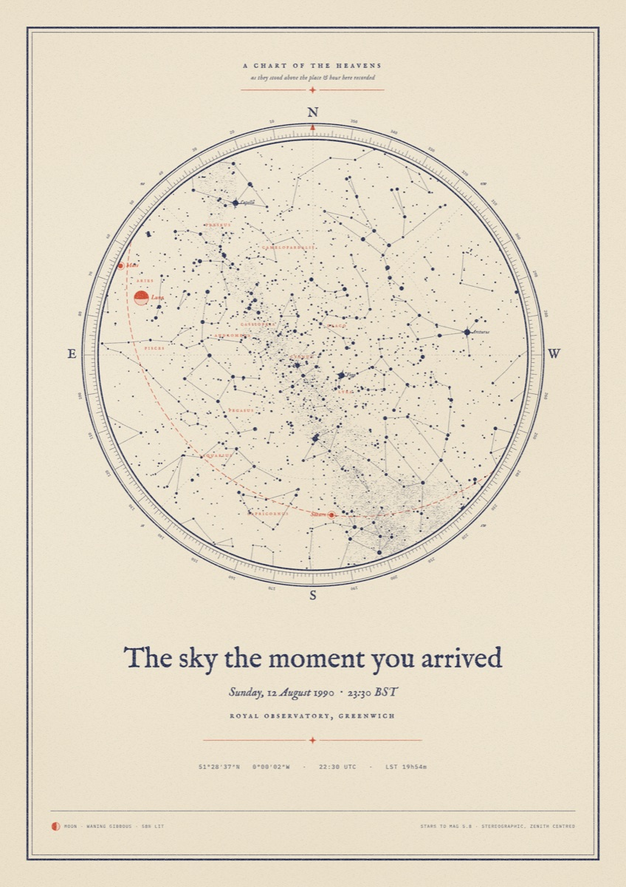
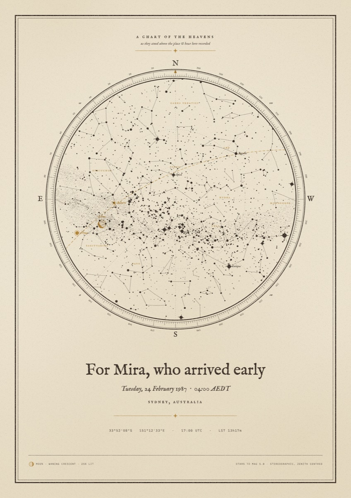
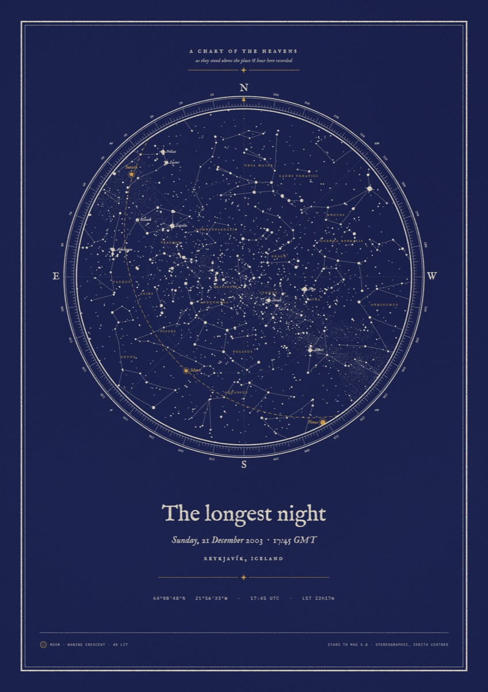

# First Light

**The sky the moment you arrived.** · [first-light.paulbouharoun.com](https://first-light.paulbouharoun.com)

"First light" is what astronomers call a telescope's first look at the sky. Here it's yours. Pick a date, a time and a place (the night you were born, the night you met someone) and First Light draws the exact sky overhead at that moment as a print-ready A3 poster.

It doesn't look like the usual star-map print with white dots on black and a script font. It's styled after 19th-century celestial atlases and printed with a risograph feel: cream stock, indigo ink, one warm accent, fine engraved linework, and some grain from the drum.

<p align="center">
  
  
  
</p>

## What it does

- **Real positions.** About 5,000 stars down to magnitude 6, plus the five naked-eye planets, the Moon with its true phase and lit limb, and the Sun if you were born in daylight. Everything is computed in the browser with [Astronomy Engine](https://github.com/cosinekitty/astronomy).
- **A real chart.** A stereographic projection centred on the zenith, as if you were lying on your back looking up: north at the top, east on the left. It has a graduated azimuth ring, altitude circles, the ecliptic, constellation figures and a stippled Milky Way.
- **Local time done properly.** The place's time zone comes from its coordinates, and historical daylight-saving rules are applied, so "23:30 in London, August 1990" means BST.
- **Print-ready.** The download is a 3508 × 4961 px PNG (A3 at 300 dpi). Ink and accent are printed as two separate layers, each with its own ink dropouts, and the accent is mis-registered by a fraction of a millimetre, the way a real riso print comes out.
- **Three plates.** *Observatory* (cream, indigo and vermilion), *Archive* (oatmeal, bistre and gold) and *Nocturne* (indigo, bone and gold).
- **Shareable.** The whole poster is stored in the URL hash, so a link brings back the same poster.

There's no backend, no API keys and no accounts. Place search uses OpenStreetMap's Nominatim, and you can also type coordinates directly (`51.48, -0.0`).

## Running it

```bash
npm install
npm run dev        # http://localhost:5180
npm test           # unit tests (synthetic fixtures, no network)
npm run build      # static site in dist/
```

`dev/proof.html` is a dev-only proof sheet. It renders a set of synthetic fixtures (different latitudes, seasons, daytime and every theme) and saves full-resolution PNGs to `proofs/` for inspection.

## How it works

```
src/
  sky/scene.ts      Astronomy Engine → J2000 zenith, planets, moon phase; d3-geo projection
  sky/time.ts       coordinates → IANA zone → UTC (with historical DST)
  render/poster.ts  the plate: layout in millimetres, two ink layers, grain, labels
  render/themes.ts  paper / ink / accent sets
  ui/               form, geocoding, URL state
scripts/build-data.mjs   compacts the d3-celestial catalogues into src/data/sky.json
```

The renderer lays everything out in millimetres on an A3 sheet and scales that to any pixel width. The on-screen preview and the 300 dpi export run the same code. The sky is projected with `d3-geo`'s stereographic projection. It's rotated so the zenith (worked out by Astronomy Engine, including precession) sits at the centre and the north point of the horizon sits straight up. d3-geo also clips constellation lines and the Milky Way exactly at the horizon.

## Credits

- Star positions, constellation figures and Milky Way outlines: [d3-celestial](https://github.com/ofrohn/d3-celestial) by Olaf Frohn (BSD-3-Clause)
- Ephemerides: [Astronomy Engine](https://github.com/cosinekitty/astronomy) by Don Cross (MIT)
- Time zones: [tz-lookup](https://github.com/photostructure/tz-lookup) (CC0)
- Places: [© OpenStreetMap contributors](https://www.openstreetmap.org/copyright) via Nominatim
- Type: IM Fell English by Igino Marini, and IBM Plex Mono (both SIL OFL)

MIT © [Paul Bouharoun](https://paulbouharoun.com)
